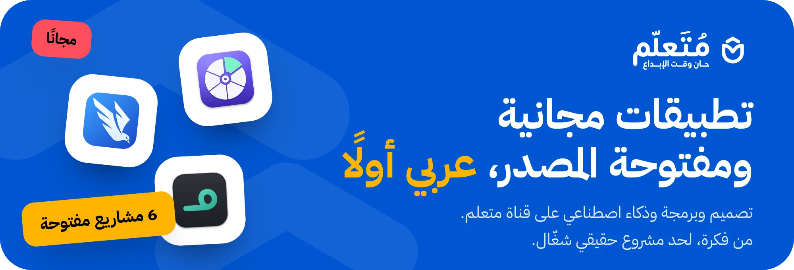
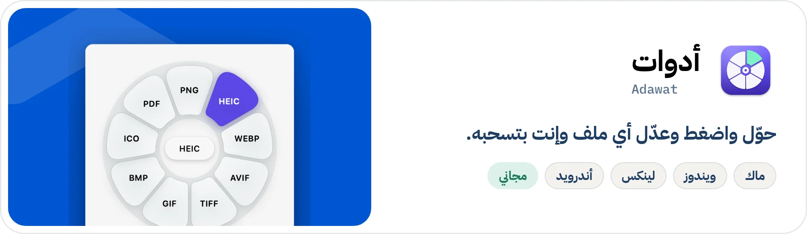
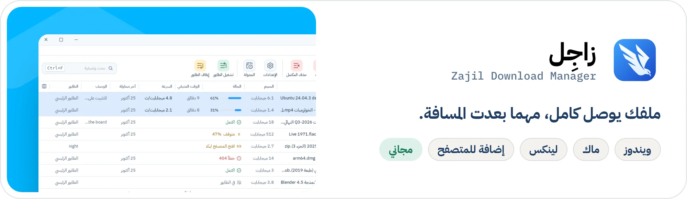
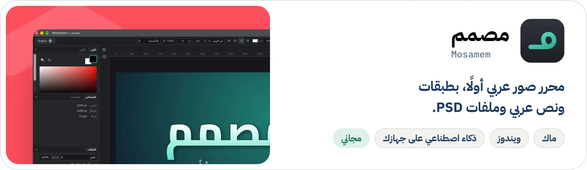
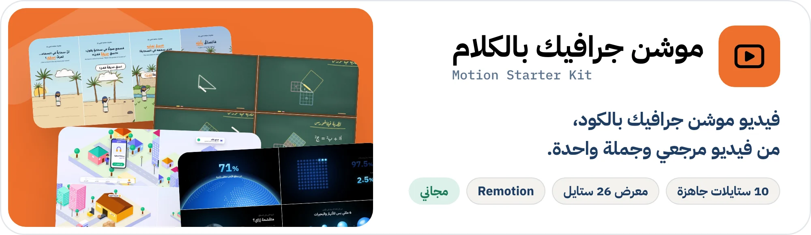
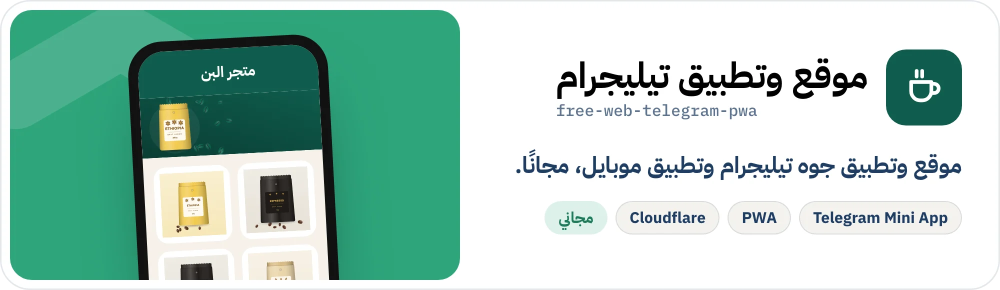

<a href="https://www.youtube.com/@motalim-ai">
  <picture>
    <source media="(prefers-color-scheme: dark)" srcset="assets/banner-dark.webp">
    
  </picture>
</a>

  

## أهلًا، أنا متعلم

صاحب قناة **[متعلم](https://www.youtube.com/@motalim-ai)** على يوتيوب: تصميم وبرمجة وذكاء اصطناعي بالعربي. ببسّط الأدوات الجديدة وبحوّلها لمشاريع حقيقية تقدر تستخدمها بنفسك.

هنا الكود بتاع التطبيقات اللي بنعملها في الفيديوهات. كلها **مجانية ومفتوحة المصدر، وعربي أولًا**: نزّلها واستخدمها، أو اقرأ الكود واتعلم منه وطوّره.

## التطبيقات

<a href="https://github.com/motalim-ai/adawat">
  <picture>
    <source media="(prefers-color-scheme: dark)" srcset="assets/projects/adawat-dark.webp">
    
  </picture>
</a>

**أدوات**: اسحب أي ملف، تطلعلك عجلة فيها التحويل والضغط والتعديل، للصور والفيديو والصوت وملفات PDF. على ماك وويندوز ولينكس وأندرويد. 
[المستودع](https://github.com/motalim-ai/adawat) · [الموقع](https://motalim-ai.github.io/adawat/) · [نزّل آخر إصدار](https://github.com/motalim-ai/adawat/releases/latest) · [شاهد الشرح](https://youtu.be/sf27x_5g00o) 

<a href="https://github.com/motalim-ai/zajil-download-manager">
  <picture>
    <source media="(prefers-color-scheme: dark)" srcset="assets/projects/zajil-dark.webp">
    
  </picture>
</a>

**زاجِل**: مدير تحميل عربي أولًا. بيحمّل الملف بأكتر من اتصال، وبيحمّل فيديوهات يوتيوب وقوائمها، ومعاه إضافة للمتصفح. على ويندوز وماك ولينكس. 
[المستودع](https://github.com/motalim-ai/zajil-download-manager) · [الموقع](https://zajil.by-wow.com) · [نزّل زاجِل](https://zajil.by-wow.com/download/) 

<a href="https://github.com/motalim-ai/mosamem">
  <picture>
    <source media="(prefers-color-scheme: dark)" srcset="assets/projects/mosamem-dark.webp">
    
  </picture>
</a>

**مصمم**: محرر صور عربي أولًا. طبقات وأقنعة، ونص عربي بالتشكيل، وملفات PSD، وذكاء اصطناعي بيشيل الخلفية على جهازك من غير إنترنت. على ماك وويندوز. 
[المستودع](https://github.com/motalim-ai/mosamem) · [نزّل آخر إصدار](https://github.com/motalim-ai/mosamem/releases/latest) · [شاهد الشرح](https://youtu.be/ITd-Fk4DK2U) 

## قوالب تبني بيها مشروعك

<a href="https://github.com/motalim-ai/motion-starter-kit">
  <picture>
    <source media="(prefers-color-scheme: dark)" srcset="assets/projects/motion-dark.webp">
    
  </picture>
</a>

**موشن جرافيك بالكلام**: ادّي الريبو لوكيل الذكاء الاصطناعي ومعاه فيديو مرجعي، يعملك فيديو موشن جرافيك بالكود في Remotion. فيه 10 ستايلات جاهزة، ومعرض فيه 26 ستايل، و17 حركة للشعار. 
[المستودع](https://github.com/motalim-ai/motion-starter-kit) · [معرض الستايلات](https://motalim-ai.github.io/motion-starter-kit/gallery/) · [شاهد الشرح](https://youtu.be/yreYVMWULLc) 

<a href="https://github.com/motalim-ai/free-web-telegram-pwa">
  <picture>
    <source media="(prefers-color-scheme: dark)" srcset="assets/projects/telegram-dark.webp">
    
  </picture>
</a>

**موقع وتطبيق تيليجرام**: فكرتك تبقى موقع، وتطبيق جوه تيليجرام، وتطبيق موبايل (PWA)، ولوحة تحكم وإشعارات بكل طلب. مجانًا على Cloudflare، وأي وكيل ذكاء اصطناعي يبنيه معاك. 
[المستودع](https://github.com/motalim-ai/free-web-telegram-pwa) · [شاهد الشرح](https://youtu.be/NKGe7Rj1S_U) 

<a href="https://github.com/motalim-ai/project-kickstart/blob/main/README.ar.md">
  <picture>
    <source media="(prefers-color-scheme: dark)" srcset="assets/projects/kickstart-dark.webp">
    
  </picture>
</a>

**ابدأ مشروعك صح**: مهارة لوكيل الذكاء الاصطناعي بتسألك عن مشروعك بلغتك، وبتكتب وثائق الأساس (AGENTS.md، وPRD، وخطة بمراحل)، وبتجهّزلك GitHub خطوة بخطوة. 
[المستودع](https://github.com/motalim-ai/project-kickstart/blob/main/README.ar.md) · [نزّل آخر إصدار](https://github.com/motalim-ai/project-kickstart/releases/latest) 

## تابعني

- **يوتيوب:** [youtube.com/@motalim-ai](https://www.youtube.com/@motalim-ai)، فيه شرح كل تطبيق هنا، وكورس الفايب كودينج، وأساسيات التصميم، والموشن جرافيك.
- **الإيميل:** [hala@motalim.com](mailto:hala@motalim.com)

## ادعم الشغل ده

كل التطبيقات دي مجانية وهتفضل مجانية. لو فادتك وعايز تساعدني أكمّل:

  &nbsp;
  

وممكن تدعمني من غير فلوس: اعمل نجمة للمستودع اللي عجبك، وشارك الفيديو مع حد محتاجه.

---

## In English

I run **[Motalim](https://www.youtube.com/@motalim-ai)** (متعلم), an Arabic YouTube channel about design, programming and AI. This is where the apps from the videos live: **free, open source and Arabic-first**. Download them, read the code, learn from it, make them better.

**Apps**

- **[Adawat](https://github.com/motalim-ai/adawat)**: convert, compress and edit any file while you drag it. macOS, Windows, Linux and Android. [Site](https://motalim-ai.github.io/adawat/) · [Download](https://github.com/motalim-ai/adawat/releases/latest)
- **[Zajil](https://github.com/motalim-ai/zajil-download-manager)**: a download manager with multi-connection downloads, YouTube videos and playlists, and a browser extension. Windows, macOS and Linux. [Site](https://zajil.by-wow.com/en/) · [Download](https://zajil.by-wow.com/en/download/)
- **[Mosamem](https://github.com/motalim-ai/mosamem)**: an image editor with layers, masks, Arabic text, PSD files and on-device background removal. macOS and Windows. [Download](https://github.com/motalim-ai/mosamem/releases/latest)

**Starter kits**

- **[Motion Starter Kit](https://github.com/motalim-ai/motion-starter-kit)**: motion graphics videos in code with Remotion, from a reference video and one sentence to your AI agent. [Style gallery](https://motalim-ai.github.io/motion-starter-kit/gallery/)
- **[free-web-telegram-pwa](https://github.com/motalim-ai/free-web-telegram-pwa)**: your idea as a website, a Telegram Mini App and a PWA, free on Cloudflare, built by any AI agent.
- **[Project Kickstart](https://github.com/motalim-ai/project-kickstart)**: start any software project the right way with an AI agent: an interview in your language, foundation docs and guided GitHub setup.

**Support:** everything here is free and stays free. If it helped you, you can support the work on [Ko-fi](https://ko-fi.com/motalim) or [PayPal](https://paypal.me/motalimai), or just star a repo and share a video.

